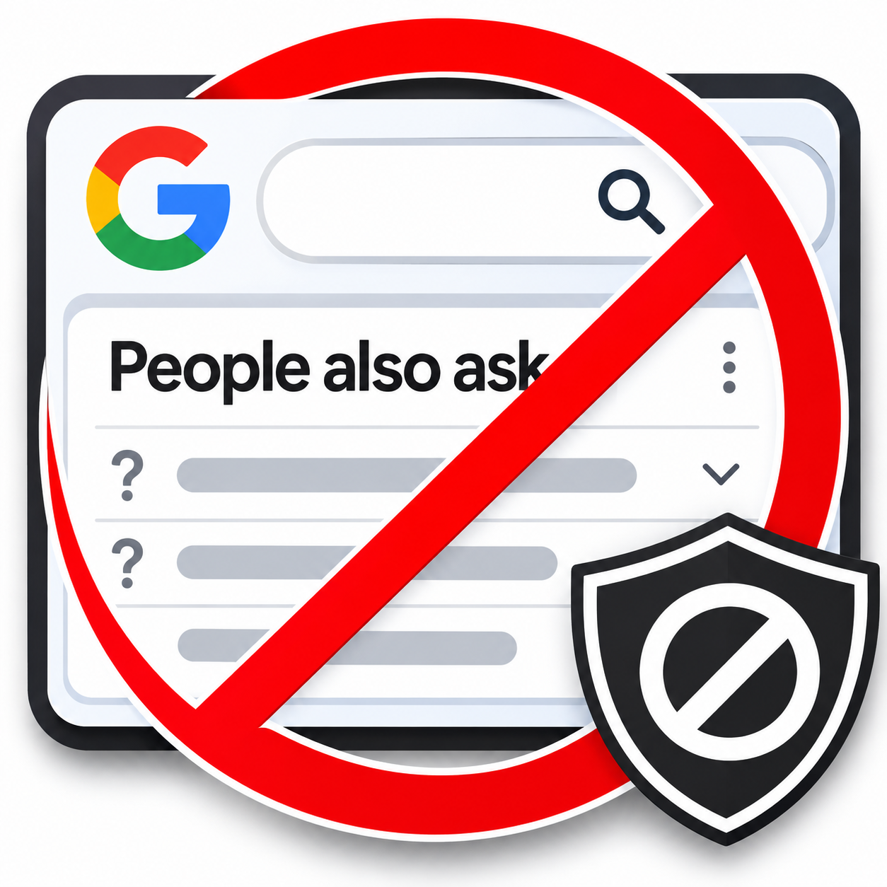

# Anti_PeopleAlosAsk
Google検索時に表示される`関連する質問`をワンクリックで表示・非表示に切り替えが出来る、Chrome系及びFirefoxでご利用頂けるアドオン（拡張機能）です。

## 開発経緯
[Googleの検索エンジン](https://www.google.com/)を使用し検索作業を行うと、検索結果の一覧上に `関連する質問` というサジェスト検索が出現する事があります。

これらは、一つ展開する度にバックグラウンドで、**新規のサジェストをリアルタイムに自動生成** しブラウザーのリソースを著しく消費します。
このアドオンは、リソース枯渇の元となり得る `関連する質問`　のリストのみをブロック（非表示）にします。

表示・非表示の切り替えはトグルスイッチでワンクリックで行え非常に軽量で、よくある広告ブロッカーによる非表示よりもパフォーマンスが優れています。

## 導入方法
1. [このリポジトリ](https://github.com/sera09036/Anti_PeopleAlosAsk.git)を`git clone`でクローンするか、`Download zip`でリポジトリを任意の場所にダウンロードしてください。

2. - Chrome系のブラウザにインストールする場合まず、`chrome://extensions/`　にアクセスし、**デベロッパーモード** を有効にし、`パッケージ化されていない拡張機能を読み込む`をクリックし、ダウンロードしたフォルダー(zipファイルの場合は解凍する事)を選択します。

    - Firefox系のブラウザの場合、`about:debugging#/runtime/this-firefox`　にアクセスし、`一時的なアドオンを読み込む`をクリックし、ダウンロードしたフォルダー内にある `manifest.json`を選択します。

3. 表示・非表示の切り替えを円滑に行うために、ツールバーに固定する事をおすすめします。

## ストアからの導入
今現在、公開登録への準備中です。

準備完了次第、改めてお知らせ致します。

